<div align="center">

# HEARTHBEAT

### Hear how home is doing · 听听家，好不好

**NASA Earth data you can hear.** An Earth Information Jukebox for the NASA Space Apps Challenge 2026
(*The Earth Information Jukebox*, Kuala Lumpur), by Team D3stiny.

[](https://github.com/yantongggg/Hearbeat_NASA/actions/workflows/deploy.yml)
[](https://yantongggg.github.io/hearthbeat/)
[](LICENSE)


**[Try it](https://yantongggg.github.io/hearthbeat/)** ·
[Demo videos](https://drive.google.com/drive/folders/19wLiQuMWGdlQFvEEmqjHYQK5JBhnh27x) ·
[Project document (PDF)](docs/Hearthbeat-D3stiny-project-document.pdf) ·
[Pitch](docs/PITCH.md) ·
[Accuracy report](docs/ACCURACY.md) ·
[Data contract](docs/DATA.md)

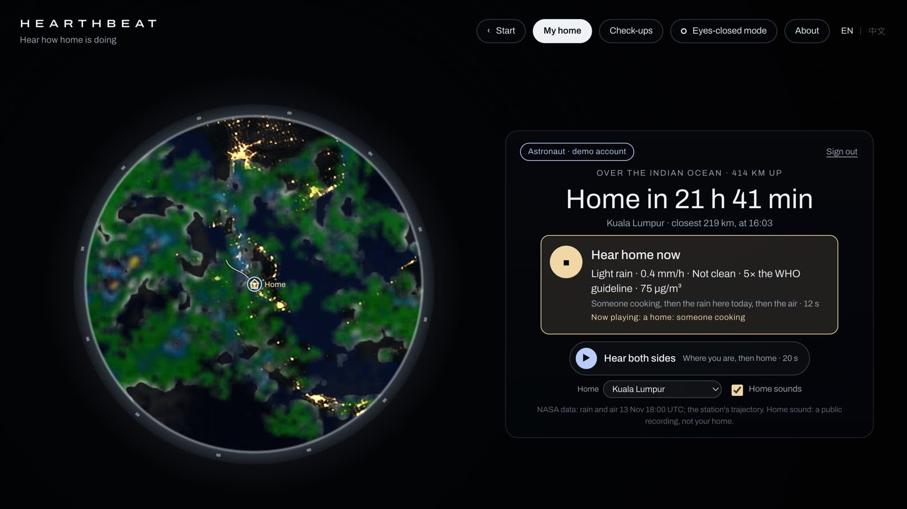

</div>

> From space, astronauts can see home, but they can't hear it. A student who cannot see is shown home only
> as colour maps. **Hearthbeat pairs NASA Earth Information Center (EIC) pictures with sound generated in
> real time from the data in each picture**, so anyone can hear how home is doing: in any browser, on a
> phone or a laptop, with eyes open or closed.

Hearthbeat is an independent project for the NASA Space Apps Challenge 2026. It is not a NASA system.

## Contents

1. [Mission](#1-mission)
2. [What it does](#2-what-it-does)
3. [From NASA data to sound](#3-from-nasa-data-to-sound)
4. [System architecture](#4-system-architecture)
5. [Verification and validation](#5-verification-and-validation)
6. [Challenge requirements, traced](#6-challenge-requirements-traced)
7. [Accessibility](#7-accessibility)
8. [Open science](#8-open-science)
9. [Run it locally](#9-run-it-locally)
10. [Add a NASA visualization](#10-add-a-nasa-visualization)
11. [Repository layout](#11-repository-layout)
12. [Limits and next steps](#12-limits-and-next-steps)
13. [Data sources and credits](#13-data-sources-and-credits)
14. [Team, disclosure and licence](#14-team-disclosure-and-licence)

## 1. Mission

| | |
|---|---|
| **Problem** | NASA's Earth Information Center publishes the planet's rain, air quality and temperature every day as colour maps. They are visual only. At least 2.2 billion people live with some vision impairment (WHO, 2019). Astronauts far from home can see it from orbit but cannot hear it; Scott Kelly wrote that his crewmates replayed a recording of Earth sounds over and over (*The New York Times*, March 2020). |
| **Users** | A student who cannot see the map; an astronaut on the International Space Station and their family at home; any classroom. |
| **Solution** | A web app that turns five NASA data sets into five musical voices, asks one place three plain questions, and lets an astronaut and their family hear each other's side of the planet, from NASA's own data. |
| **Principle** | Every sound comes from NASA data at the place you are listening to. Nothing is simulated: if data is missing, the track is switched off and says why. |

### Why it matters: what the research says

The challenge names the gap: relying on sight alone "limits accessibility for blind and low-vision users", and
it asks for sound that is "musically pleasing" and builds "a deeper emotional connection to our home planet".

| Finding | What Hearthbeat does with it |
|---|---|
| **Sound opens NASA data to more people.** In NASA's *A Universe of Sound* study, 3,184 blind, low-vision and sighted participants reported significant learning gains and positive experiences from sonified NASA data; the work was done with blind and low-vision partners. [1] | Brings the same idea to NASA's *daily* Earth data, and to the place people care about most: home. |
| **One design can serve everyone.** Blind and sighted listeners showed remarkably similar preferences for how data maps to sound. [2] | One app, not a separate "accessible version": more drops for more rain, a faster heartbeat for dirtier air, a higher note for a warmer year. |
| **The need is here.** At least 2.2 billion people live with a vision impairment [3]; Malaysia's National Eye Survey estimated 1.2 % blindness and 5.9 % moderate visual impairment among adults aged 50 and over. [4] | Eyes-closed mode, speech, keyboard and haptics are first-class; English and Chinese; a tactile map in the classroom pack. |
| **The air is a daily concern.** 99 % of the world's population breathes air above WHO guideline limits, and South-East Asia is among the worst regions. [5] On 14 Nov 2026 NASA's GEOS-CF put Kuala Lumpur at 75 µg/m³, 5× the 24-hour guideline. | The air is a heartbeat you notice without reading a map; the exact number follows, as a guide, not a health warning. |
| **Calm natural sound is good for people.** Natural sounds are linked to lower stress and better health outcomes, water sounds most of all. [6] | Rain is gentle drops; major keys and round tones; no alarms or noise bursts. |
| **Isolation is a known spaceflight hazard.** NASA's Human Research Program lists isolation and confinement among the hazards of spaceflight; countermeasures for longer missions are still being developed and validated. [7] | *Together* gives an astronaut and their family a shared sound of home and of the station's path, made on the device from small NASA data files, with no live call needed. |

<sub>[1] Arcand, K. K. et al. (2024), A Universe of Sound: processing NASA data into sonifications to explore participant response, *Frontiers in Communication* 9, [doi:10.3389/fcomm.2024.1288896](https://doi.org/10.3389/fcomm.2024.1288896) · [2] Walker, B. N. and Mauney, L. M. (2010), Universal design of auditory graphs: a comparison of sonification mappings for visually impaired and sighted listeners, *ACM Transactions on Accessible Computing* · [3] WHO (2019), World report on vision · [4] Estimates of visual impairment and its causes from the National Eye Survey in Malaysia (NESII), *PLoS ONE* (2018) · [5] WHO (2022), air quality database update · [6] Buxton, R. T. et al. (2021), A synthesis of health benefits of natural sounds and their distribution in national parks, *PNAS* 118(14), [doi:10.1073/pnas.2013097118](https://doi.org/10.1073/pnas.2013097118) · [7] NASA Human Research Program, Risk of Adverse Cognitive or Behavioral Conditions and Psychiatric Disorders</sub>

## 2. What it does

<table>
<tr>
<td width="50%">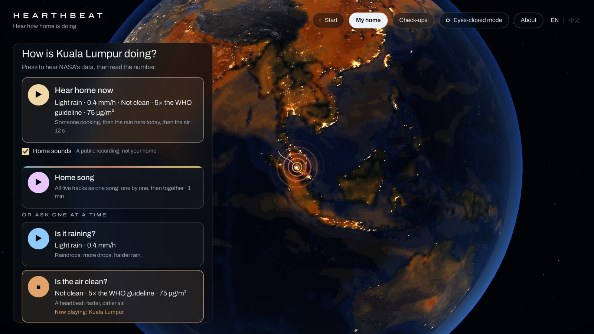<br><b>Hear my home.</b> Choose a place and ask: <i>Is it raining? Is the air clean? How much warmer than in 1951–1980?</i> Each answer is a short sound, then NASA's number. <i>Hear home now</i> plays a household recording, then the rain on its window, then the air as a heartbeat.</td>
<td width="50%">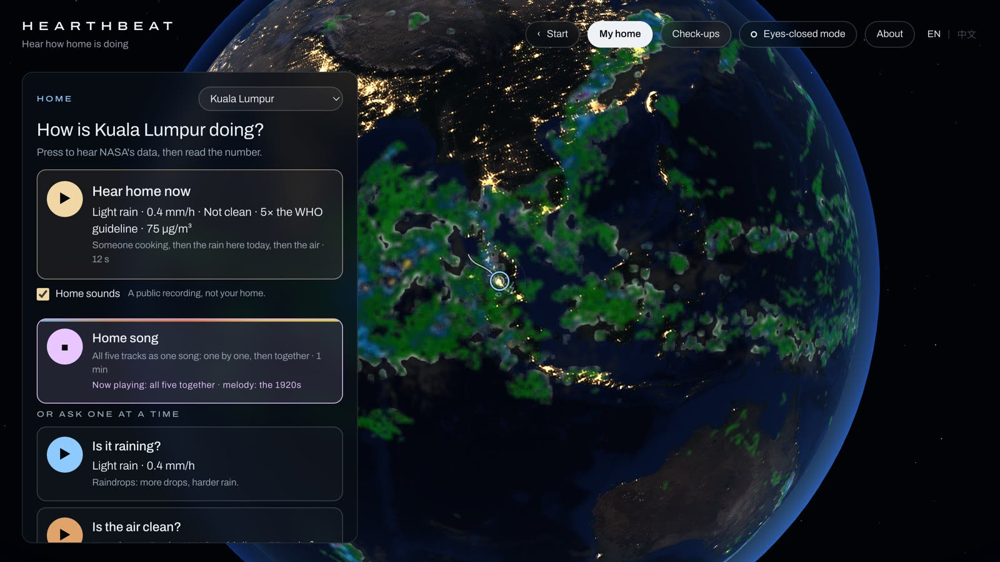<br><b>Home song.</b> All five tracks as one song for one place: D major, 84 beats a minute, about a minute. The warming since the 1880s is the melody; air, rain, lightning and night lights join two bars apart, then all five play together.</td>
</tr>
<tr>
<td><br><b>Together: astronaut.</b> The globe through a porthole that follows the ISS where NASA's predicted trajectory puts it now, home marked below, and a countdown to the next pass over home.</td>
<td>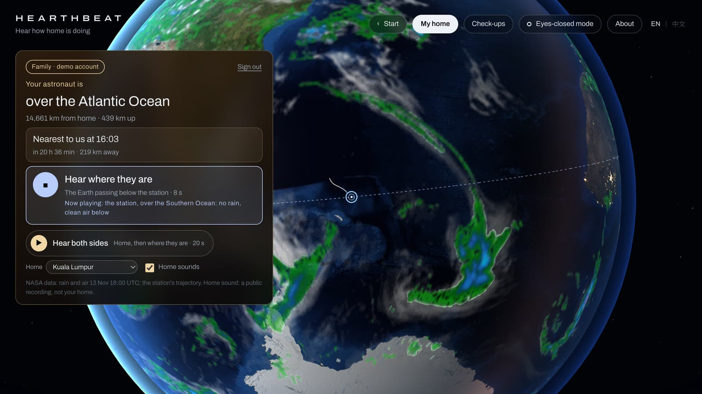<br><b>Together: family.</b> "Your astronaut is over the Atlantic Ocean." <i>Hear where they are</i> plays the Earth passing below the station, with NASA's rain and air under its path. <i>Hear both sides</i> plays home and the station's side.</td>
</tr>
<tr>
<td>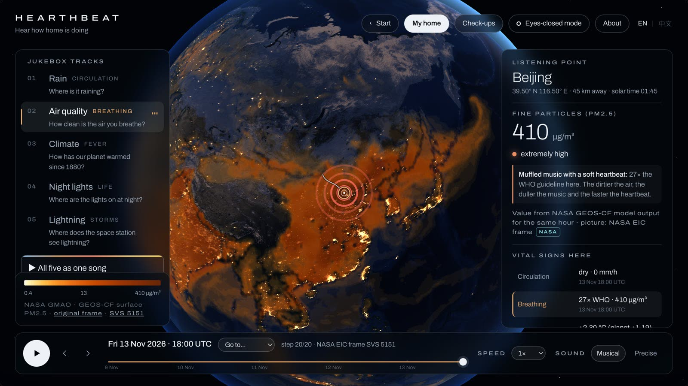<br><b>Explore the globe.</b> Five jukebox tracks over a 3D globe. Move the listening point (click, tap or arrow keys); the sound follows the NASA frame under it. A timeline steps through the last five days, or 146 years of warming.</td>
<td>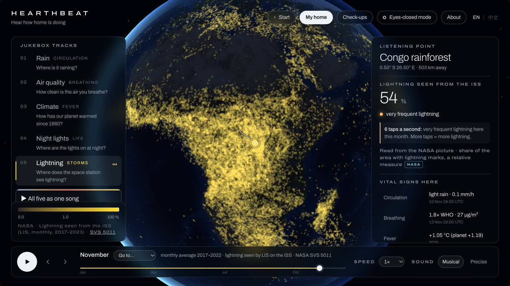<br><b>Lightning seen from the ISS.</b> Marimba taps where the space station's lightning sensor saw lightning in this month (here: the Congo rainforest, 25 % of the area with lightning marks).</td>
</tr>
<tr>
<td>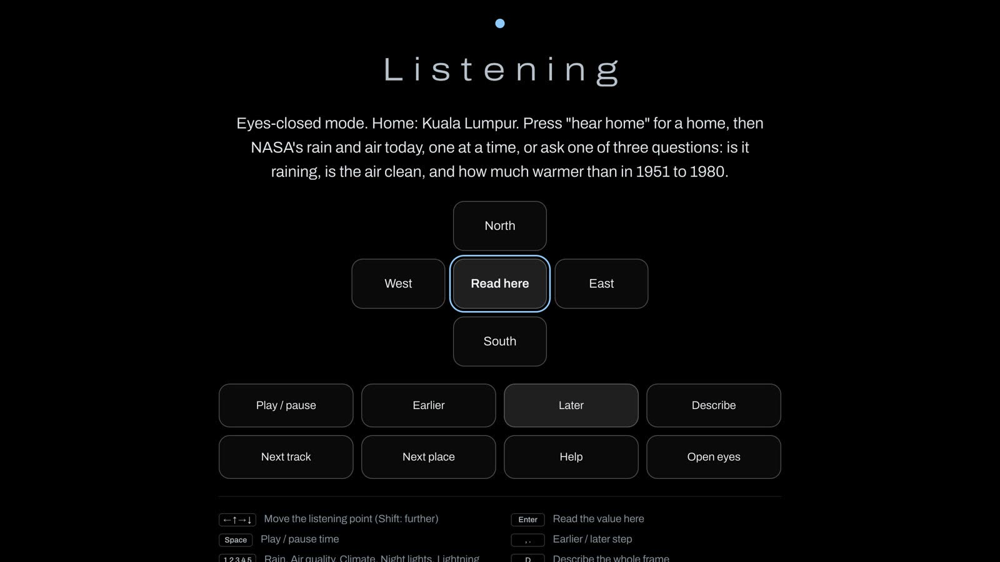<br><b>Eyes-closed mode.</b> Black screen, large buttons, full keyboard control; everything is spoken.</td>
<td>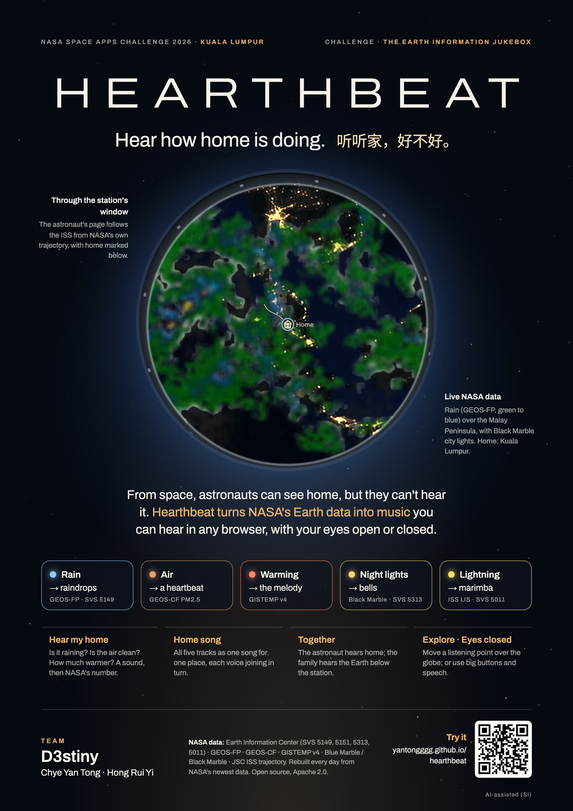<br><b>Check-ups for class</b> (not shown): four questions, such as where it rains hardest in Southeast Asia, answered by ear and checked against the data, with a CSV log for a listening test. Plus a <a href="docs/classroom/">classroom pack</a> in English and 中文.</td>
</tr>
</table>

<p align="center">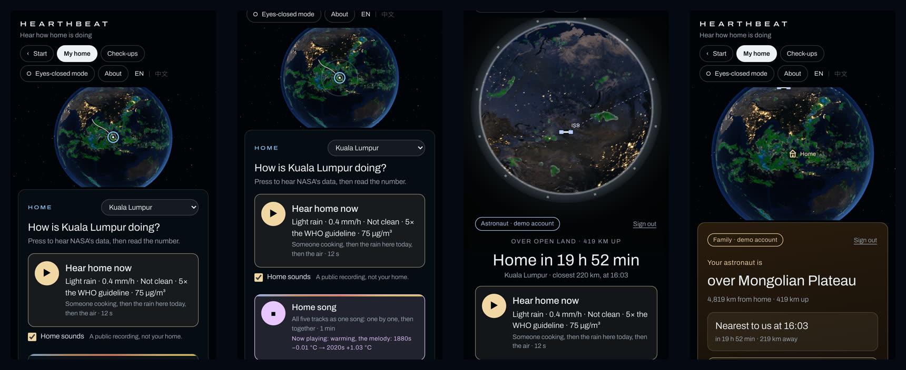<br><sub>On a phone (emulated iPhone 14): Hear my home, the Home song playing, the astronaut page, the family page. Screenshots of the live site, 14 November 2026.</sub></p>

## 3. From NASA data to sound

| | Track (vital sign) | You hear | NASA data | Steps |
|---|---|---|---|---|
| 01 | **Rain** (circulation) | Raindrops: 1 a second in light rain, 10 a second at 20 mm/h, a soft low note in heavy rain | EIC / SVS 5149, GEOS-FP precipitation | last 5 days, every 6 h |
| 02 | **Air quality** (breathing) | Music muffled as PM2.5 rises; above the WHO 24-hour guideline (15 µg/m³) a heartbeat, 60 → 140 beats a minute | GEOS-CF v2 PM2.5 values; EIC / SVS 5151 picture | last 5 days, every 6 h |
| 03 | **Warming** (fever) | One music-box note per year, higher when warmer than 1951–1980 | GISTEMP v4 surface temperature anomaly | 1880 → 2025 |
| 04 | **Night lights** (life) | Bells, more where there is more light at night | EIC / SVS 5313, Black Marble (VIIRS), relative index | 2012 → 2023 |
| 05 | **Lightning** (storms) | Soft marimba taps, more where the station saw more lightning | SVS 5011, LIS on the ISS, share of area with NASA's marks | each month, 2017–2023 |

**Sound design rules.** One data voice per track in front of a quiet musical bed; major keys only; round
wooden and music-box tones; no noise bursts or deep thuds. Levels are measured, not guessed: the Home song's
chorus stays below −16 dBFS with no clipping and almost no energy below 150 Hz. A **Precise** mode replaces the
music with a single tone whose pitch is the value. Every sound is also drawn as a ripple at the listening point.

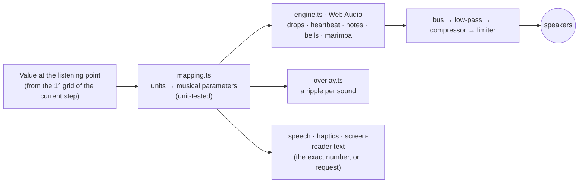

## 4. System architecture

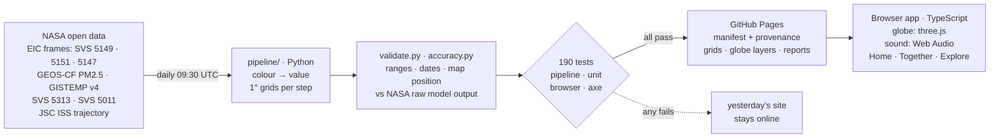

| Layer | Where | What it does |
|---|---|---|
| Pipeline | [`pipeline/`](pipeline/) (Python) | Config-driven ([`sources.json`](pipeline/sources.json)). Downloads EIC frames and reads every pixel back to a value through the visualization's own colorbar ([`colorbar.py`](pipeline/hearthbeat_pipeline/colorbar.py), [`svs.py`](pipeline/hearthbeat_pipeline/svs.py)); takes PM2.5 numbers from GEOS-CF over OPeNDAP ([`raw.py`](pipeline/hearthbeat_pipeline/raw.py), [`opendap.py`](pipeline/hearthbeat_pipeline/opendap.py)); reads GISTEMP ([`climate.py`](pipeline/hearthbeat_pipeline/climate.py)), the night-lights and lightning movies frame by frame ([`nightlights.py`](pipeline/hearthbeat_pipeline/nightlights.py), [`lightning.py`](pipeline/hearthbeat_pipeline/lightning.py)) and the ISS trajectory ([`station.py`](pipeline/hearthbeat_pipeline/station.py)). A failing layer keeps its last good data or is switched off with a reason. |
| Validation | [`validate.py`](pipeline/hearthbeat_pipeline/validate.py), [`accuracy.py`](pipeline/hearthbeat_pipeline/accuracy.py) | Checks every layer before it replaces the published data; measures recovered values against NASA's raw model output. |
| Data contract | [`docs/DATA.md`](docs/DATA.md) | The only interface between pipeline and app: `manifest.json` (each layer's source page, product, agency, citation, units, encoding, timing) plus grids, globe layers and reports. |
| App | [`app/`](app/) (Vite, TypeScript) | [`globe/`](app/src/globe/) three.js Earth with the NASA frame; [`audio/`](app/src/audio/) mapping, engine and Home song; [`data/`](app/src/data/) grids, station position, home logic; [`ui/`](app/src/ui/) Home, Together, Explore, check-ups, About, speech. |
| Automation | [`.github/workflows/`](.github/workflows/) | `deploy.yml`: daily refresh → validate → accuracy → tests → build → GitHub Pages. `probe.yml`: probes new NASA sources. |

## 5. Verification and validation

**Is the data right?** Values read back from NASA's pictures were compared with NASA's raw model output for
the same hour and place ([`docs/ACCURACY.md`](docs/ACCURACY.md)):

| Check | Result | What we did with it |
|---|---|---|
| Temperature read from EIC pictures (about 400 places) | RMSE 0.58–0.77 °C, r 0.998–0.999 | Cells under NASA's logo and date label are stored as no data |
| Rain read from EIC pictures (rainy points) | RMSE 0.30–0.52 mm/h, r 0.33–0.82 | Rain amounts are presented as a guide |
| PM2.5 read from EIC pictures | about 4× too low on a compressed scale | PM2.5 numbers now come straight from GEOS-CF |
| ISS position vs NASA's listed equator crossings | latitude 0.00°, longitude within 0.001° | Outside the trajectory file's dates no position is shown |
| Lightning map position and seasons | aligned with the coastlines; Florida peaks in July, Johannesburg and Darwin in January, Kuala Lumpur all year | Monthly climatology, 2017–2023 |
| Data freshness | the app says "today" only when the newest step is under 36 hours old | Otherwise it gives the date |

**Does the software do what it says?** 190 automated tests run before every deploy, and the site is
published only if all of them pass.

| Suite | Tests | Covers |
|---|---|---|
| Pipeline (pytest) | 75 | colorbar decoding, movie frame dates, validation rules, OPeNDAP client, ISS trajectory parsing |
| Unit (Vitest) | 51 | data → sound mapping, Home song arrangement, station position, home logic, check-ups, descriptions |
| Browser (Playwright, on the production build) | 64 | every page and entry path on desktop, laptop and phone layouts, sound events, eyes-closed mode, layout at short windows while playing |
| Accessibility (axe-core in Playwright) | in the browser suite | WCAG 2.1 A/AA scans and keyboard-only use |
| Sound levels | in the browser suite, run locally | no clipping, chorus below −16 dBFS, energy below 150 Hz measured |

Every published build also ships its own `validation.json` and `accuracy.json`, which the app's *About the data*
page shows.

## 6. Challenge requirements, traced

| The challenge asks for | Hearthbeat | Verified by |
|---|---|---|
| EIC visual frames paired with "dynamic sonifications generated in real time" | Every sound is synthesized in the browser from the value under the listening point, while the globe shows the matching EIC frame | unit tests of the mapping; browser tests of sound events per track |
| Users choose a visualization and hear its soundscape | Five jukebox tracks, a timeline and *Go to…* for any step | browser tests (track switching, keys 1–5) |
| Use of the NASA visualizations listed for the challenge | SVS 5313 (night lights) and SVS 5011 (ISS lightning) are tracks; SVS 5533 and 13786 are cited for comparison | pipeline tests; data tests of seasons |
| Accessibility as a core theme | Eyes-closed mode, keyboard control, screen-reader text, speech, haptics, English and 中文 | axe WCAG 2.1 A/AA scans; keyboard tests |
| Musical sound, not noise | Major keys, measured levels, one voice per track | level tests (dBFS, energy below 150 Hz) |

## 7. Accessibility

- **Eyes-closed mode:** a black screen, a large-button pad and full keyboard control; every value and result is spoken.
- **Screen readers:** live regions, labelled controls and a text description of the whole frame (key **D**).
- **Keyboard:** arrows move the listening point, **Enter** reads the value, **L** plays the sound legend, **C** compares two places, **P** jumps to the next interesting place.
- **Phones:** vibration on class changes; the layout fits phones and short laptop windows.
- **Languages:** English and 中文 throughout, including the classroom pack.
- **Honest status:** checked with automated axe scans and keyboard tests in Chromium only. It has not yet been tested with VoiceOver, TalkBack, NVDA or JAWS, or by a blind or low-vision user.

## 8. Open science

Hearthbeat follows the spirit of NASA's open science work (Transform to Open Science) and the FAIR principles:

- **Findable:** every layer in `manifest.json` names its NASA source page, product, agency and citation; this README lists every SVS id.
- **Accessible:** free in any browser, no account, no tracking; the data files are static and public.
- **Interoperable:** a documented data contract ([`docs/DATA.md`](docs/DATA.md)), regular 1° latitude–longitude grids, ISO 8601 times, CCSDS OEM input, CSV export of check-up results.
- **Reusable:** Apache 2.0, a [`NOTICE`](NOTICE) with every third-party licence, a config-driven pipeline and a workflow that probes new NASA visualizations.

## 9. Run it locally

```bash
# data (optional: the committed, validated snapshot works without this)
cd pipeline && python3 -m venv .venv && .venv/bin/pip install -r requirements.txt
.venv/bin/python -m hearthbeat_pipeline.build --out ../app/public/data
.venv/bin/python -m hearthbeat_pipeline.accuracy --out ../app/public/data/accuracy.json
.venv/bin/python -m pytest -q

# app
cd ../app && npm install
npm run dev            # http://localhost:5173
npm test               # unit tests (Vitest)
npx playwright install chromium && npm run test:e2e   # browser + axe accessibility tests, on the production build (silent)
npm run build          # static site in app/dist
```

The night-lights and lightning layers need `ffmpeg` to read NASA's movies.

## 10. Add a NASA visualization

NASA published the challenge's resources on 13 November 2026: the EIC content database
(<https://svs.gsfc.nasa.gov/gallery/earth-information-center/>) and ten SVS pages (13786, 5313, 3912, 5669,
5533, 5425, 5196, 5011, 4960, 4950). Two are tracks today: **SVS 5313** (night lights 2012–2023, EIC version;
its frame folder is not public, so [`nightlights.py`](pipeline/hearthbeat_pipeline/nightlights.py) reads NASA's
movie) and **SVS 5011** (lightning seen from the ISS, 2017–2023, read by
[`lightning.py`](pipeline/hearthbeat_pipeline/lightning.py) from NASA's Science On a Sphere movie and its frame
dates; it also plays on the station's side in Together). To add another:

1. **Actions → Probe new NASA sources → Run workflow** and paste the resource list (links, text or SVS ids), or
   locally `python -m hearthbeat_pipeline.probe --from-text resources.txt --stubs stubs.json`.
2. Copy the draft entry into [`pipeline/sources.json`](pipeline/sources.json), fill `min`, `max`, `scale` and
   `unit` from the colorbar labels, set `"enabled": true`, and point a theme at it in `themes`.
3. **Actions → Build and deploy → Run workflow**. The build validates the new layer before publishing; the app
   picks it up from the manifest.

## 11. Repository layout

```
hearthbeat/
├── pipeline/                    Python: NASA data → validated grids
│   ├── hearthbeat_pipeline/     build · svs · colorbar · raw · opendap · climate · nightlights · lightning · station · validate · accuracy · probe
│   ├── sources.json             which NASA layers to build, and how
│   └── tests/                   75 offline tests
├── app/                         TypeScript web app (Vite)
│   ├── src/audio/               mapping.ts · engine.ts · song.ts
│   ├── src/globe/               earth.ts · overlay.ts (three.js)
│   ├── src/data/                grids · manifest · station · home logic · check-ups
│   ├── src/ui/                  home · controls · check-ups · about · speech · text
│   ├── public/data/             the published, validated NASA data
│   ├── tests/                   51 unit tests
│   └── e2e/                     64 browser and accessibility tests
├── docs/                        PITCH · DATA · ACCURACY · DEMO · SUBMISSION · classroom/ · media/
└── .github/workflows/           deploy.yml (daily) · probe.yml
```

## 12. Limits and next steps

- **Not yet tested with people.** No listening test and no test with blind or low-vision users has been run; the
  check-up log and [`docs/classroom/`](docs/classroom/) are ready for one. Next: a listening test and screen-reader
  testing (VoiceOver, TalkBack).
- **Model data, not measurements.** Rain and air quality are NASA model analyses and short forecasts. The air classes
  compare hourly values with a 24-hour guideline: a guide, not a health warning.
- **Relative indexes.** The night-lights picture has no colour scale, so its value is a relative light index; lightning
  is the share of area with NASA's marks.
- **Demo sign-in.** The astronaut and family sign-in is a one-press demo with no accounts. The home sounds are public
  recordings, not your home.
- **Devices.** The phone layout was checked in emulated phones (Chromium), not yet on a real device.

**How far it solves the problem today**

| Need | Working today | Not yet proven |
|---|---|---|
| Hear NASA's Earth data without seeing it | Five tracks, Home questions, eyes-closed mode, speech, keyboard, haptics | No blind or low-vision listener has tried it yet |
| Numbers people can trust | Daily validation; accuracy measured against NASA's raw model output | Rain amounts are a guide (r 0.33–0.82) |
| A felt connection to home | Hear my home, Home song, Together | The feeling of connection has not been measured |
| Usable by anyone, anywhere | Free, any browser, phone layout, no account, English and 中文 | Not yet tried on a real phone or with screen readers |

**Next: prove it with the people it is for** (a plan; no organisation has been contacted yet)

1. A listening test with blind and low-vision students in Malaysia, with a school or association for the blind. The
   four check-ups already log task success, time and hints as CSV: can a student find the heaviest rain or the dirtier
   air by ear, and how sure do they feel?
2. Screen-reader testing with VoiceOver, TalkBack and NVDA, and fixing what users report.
3. Families apart. *Together* works for anyone far from home, not only astronauts: students abroad, workers offshore,
   families split across countries. A small pilot would ask whether hearing each other's side feels like being together.
4. Classrooms and museums: the classroom pack and the open-source app are free to use today.
5. Crews on long missions: home sounds made on board from small NASA data files still work when a live call is delayed.

The app stays free and open source; running costs are close to zero (static hosting, open NASA data). More in
[`docs/PITCH.md`](docs/PITCH.md).

## 13. Data sources and credits

**NASA data**

- NASA Scientific Visualization Studio, Earth Information Center daily visualizations: SVS 5149 (GEOS-FP precipitation),
  SVS 5151 (GEOS-CF surface PM2.5), SVS 5147 (GEOS-FP near-surface temperature, a context value); NASA GMAO.
- NASA GMAO GEOS-CF v2 surface PM2.5 (`pm25_rh35`), NCCS OPeNDAP, for the PM2.5 numbers and the accuracy test.
- NASA GISS Surface Temperature Analysis (GISTEMP v4), 1880–2025; Lenssen et al. (2019), Improvements in the GISTEMP
  uncertainty model.
- NASA SVS 5313, "Change in Night Lights between 2012 and 2023 – EIC Version" (visualizer Kel Elkins, USRA; scientists
  Zhuosen Wang, Miguel Román, Ranjay Shrestha, Srija Chakraborty, Virginia Kalb), from Black Marble: Next Generation,
  NASA/NOAA Suomi NPP VIIRS.
- NASA SVS 5011, "Lightning Events Detected from the International Space Station (ISS) 2017–2023" (visualizers Michala
  Garrison, SSAI; Greg Shirah, NASA/GSFC; Kel Elkins, USRA; Alex Kekesi, GST). Data: Blakeslee, R. J. (2020), Quality
  Controlled LIS on ISS Science Data, NASA GHRC DAAC.
- International Space Station predicted trajectory: NASA Johnson Space Center, Flight Operations Directorate (TOPO),
  `ISS.OEM_J2K_EPH.txt` (CCSDS OEM).
- NASA Visible Earth: Blue Marble and Black Marble, for the globe.
- Compared with, not used as data: SVS 5533 (Air Quality Model Runs, GEOS-CF) and SVS 13786 (Data Sonification: Caldwell 73).

**Other references and material**

- World Health Organization: global air quality guidelines (2021), 24-hour PM2.5 guideline 15 µg/m³ and interim
  targets (the class names are Hearthbeat's own); World report on vision (2019).
- American Meteorological Society, Glossary of Meteorology: rain intensity classes.
- Scott Kelly, "I Spent a Year in Space, and I Have Tips on Isolation to Share", *The New York Times*, March 2020.
- Coastlines: Natural Earth (public domain), through `world-atlas`.
- Sounds of a home: public-domain recordings from Wikimedia Commons with no voices, listed with author, source and
  changes in `app/public/home-sounds/manifest.json` and the app's About page. The Space Apps terms bar audio of anyone
  under 18 and need third-party material to be free of restrictions, so two earlier clips (a father and son, children
  playing; CC BY-SA) were removed on 13 November.
- Libraries: three.js, d3-geo, topojson-client, Vite, Vitest, Playwright, axe-core; numpy, Pillow, requests, netCDF4,
  reportlab. Fonts: Archivo and Noto Sans SC (SIL OFL 1.1). Licences: [`NOTICE`](NOTICE).

## 14. Team, disclosure and licence

**Team D3stiny:** Chye Yan Tong · Hong Rui Yi. NASA Space Apps Challenge 2026, Kuala Lumpur.

This repository publishes a snapshot of existing work. Its first commit marks publication of this snapshot.

**Updates on 14 November 2026:**

- Track 05: lightning seen from the ISS, from NASA SVS 5011 (one of the challenge's listed visualizations), also on the station's side in *Together*.
- *Home song*: all five tracks as one song for one place.
- The public repository and the live site, rebuilt every day from NASA's newest data after every test passes.
- *Hear my home* and the astronaut page kept apart; the *Together* pages fitted to short laptop windows and phones.
- The 30-second demo, the 4½-minute project video, the team poster and the project document.

**Use of AI (the Space Apps form calls it Super Intelligence, SI).** Most of the code, tests and documentation were
written with an AI coding assistant, directed and reviewed by the team. The sounds are synthesized at run time by
[`app/src/audio/engine.ts`](app/src/audio/engine.ts) from NASA data, the home sounds are recordings made by people, and
the globe pictures are NASA's. The screenshots in [`docs/media/`](docs/media/) are captures of the app; the team
poster, the demo videos and the project document were assembled with AI assistance from screen recordings of the app
and carry a visible "AI-assisted (SI)" mark.

**Licence.** Code and documentation: Apache License 2.0 ([`LICENSE`](LICENSE)). Third-party material keeps its own
terms ([`NOTICE`](NOTICE)).
